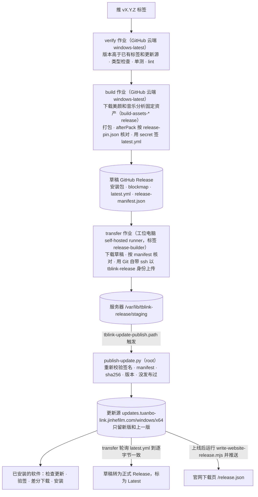
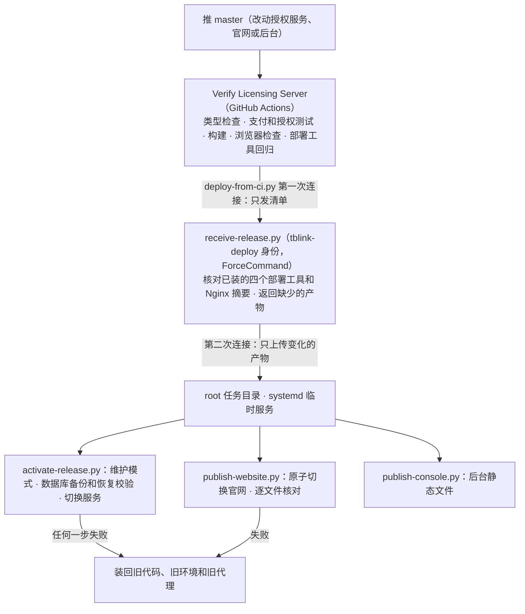
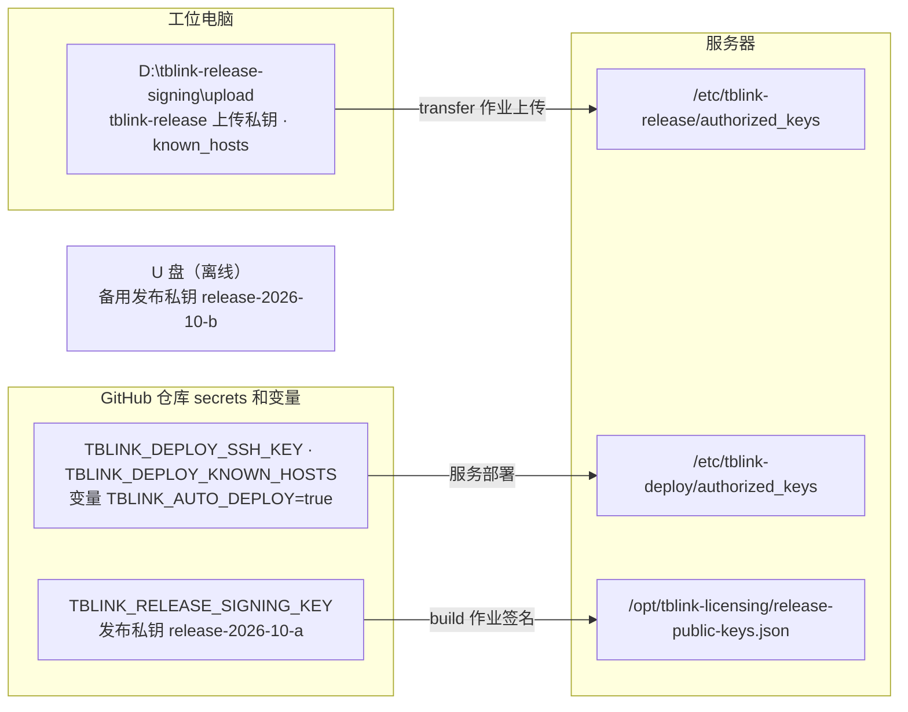

# 团播联动台

面向 Windows 团播现场的节目编排与设备联动软件。在一个工作区内管理节目、播放音乐、编排画面与灯光，并联动 OBS Studio、MIDI、P1 和 grandMA2。

**当前发行：0.5.0 · Windows x64**

本仓库包含桌面端源码、设备桥接工具、自动化测试和实施文档。0.5.0 于 2026-10-24 发布，官网开放下载与支付宝购买。0.4.29 时 Windows CI 已验证正式安装版的未激活拦截、覆盖安装、正常关闭和卸载，以及真实更新器的公网完整下载和损坏包拒绝。真实付款激活、两版本重启更新与现场设备验收仍待完成，见[授权与更新验收](docs/LICENSE_UPDATE_ACCEPTANCE.md)。

[产品官网与购买](https://tuanbo-link.jinhefilm.com/) · [下载 Windows 0.5.0](https://updates.tuanbo-link.jinhefilm.com/windows/x64/Tuanbo-Link-Console-0.5.0-x64.exe) · [发布与部署链路](#发布与部署链路) · [0.4.29 发行记录](docs/RELEASE_0.4.29.md)

0.4.27 仍使用旧 GitHub 更新源。首次迁移请保存工程、退出软件，再用官网安装器覆盖原目录；新版使用公司更新源，无需填写 GitHub Token。具体步骤见[旧安装迁移](docs/SOFTWARE_UPDATES.md#旧安装迁移与故障)。

安装包目前未做 Authenticode 签名，Windows 可能显示未知发布者或 SmartScreen 提示。

## 核心能力

运营端另有 [订单与激活码管理后台](docs/OPERATIONS_CONSOLE.md)：已部署到腾讯云上海并接通独立 HTTPS，首个负责人已开通并登录，支持账号二次验证、角色权限、核款发码、撤销换机及售后记录；异地备份与真实交易验收仍待完成。

| 工作区 | 功能 |
| --- | --- |
| 节目单 | 播放列表、紧凑卡片与列表视图、搜索、音视频文件拖入新建节目、框选与右键批量删除 |
| 音乐播放 | 波形定位、播放与停止、音量、淡入淡出、播放顺序、正计时与倒计时、频谱与电平监控 |
| 画面编辑器 | OBS 实时画布、多轨时间线、素材裁剪与分割、Cue 编排、可拖动调整的预览/属性/时间线分区 |
| 灯光工作台 | 效果素材库、Cue 组合、灯光轨道、节拍辅助、MIDI/MSC 动作、MA2 导入与同步流程 |
| 设备设置 | OBS、MA2、音频与 MIDI、虚拟 MIDI、设备诊断和连接结果反馈 |
| 工程管理 | 自动保存、撤销/重做、素材管理、预检、运行日志和错误提示 |

界面支持深色、浅色及跟随系统。时间码状态集中在软件顶部，点击 MTC 入口可查看详情、切换输出并进入音频与 MIDI 设置。

已保存 OBS 连接配置后，默认在软件启动时尝试启动并连接 OBS；可在设备设置中关闭“启动时自动连接”。OBS 或 MA2 暂时离线时，工程仍可打开，顶部显示未连接及原因。连接尝试只执行一次；设备恢复后可手动连接。

顶部“一键连接”会识别并启动本机 MA2 onPC 与 MA 3D，复用已经运行的相同程序，再检查 MA2 网络与工程通信。可在“设置 → MA2 控台 → 本机控台与预演”选择配套版本、关闭某个程序的一键启动；已有选择不会被自动识别覆盖。多版本无法唯一识别时需手动选择程序。MA 3D 加入控台会话和 MIDI 接收仍需分别核对，程序运行不代表时间码已送达。

节目单的框选用于选择节目，不是浏览器文字拖选。批量操作通过右键菜单或 Delete 执行；删除节目支持撤销，不删除原始媒体文件。

## 两种播放方式

### 内部音乐主控

由联动台播放正式音乐，以实际媒体播放位置驱动时间线，并输出 MIDI 时间码。音乐可通过应用自有的 OBS 音频来源接入正式输出。

适合在联动台内统一管理节目、音乐、画面与灯光的工作流。

### P1 跟随

由 P1 播放音乐，联动台接收真实 MTC，按已确认的歌曲区间匹配节目并执行编排。支持 P1 工程读取及联动工程生成；生成后需要操作员在 P1 中打开，当前不提供自动热重载。

两种方式必须明确选择。P1 断线时不会自动切到内部计时，也不会用无音频空跑代替真实播放。

P1 电脑不在同一局域网时，把 `.hia` 与工程引用的歌曲文件夹一起复制到本机。在 **设置 → 设备连接 → MA2 控台 → 导入外部 P1 音乐与控台 Cue** 选择 `.hia`；软件保留原始歌曲时间码，配对已连接控台中能唯一确认的时间线，并在编辑器按歌曲显示 Cue。缺失音频、同名冲突或无法唯一配对的时间线会列为待核对，详见下方导入说明。

详细说明：[内部主控](docs/INTERNAL_PLAYER.md) · [P1 自动跟随](docs/P1_AUTO_FOLLOW.md) · [P1 音乐与 MA2 灯光导入](docs/P1_MA2_PROGRAM_TRANSFER.md)

## 软件分工

| 软件 | 职责 |
| --- | --- |
| 团播联动台 | 节目管理、音乐主控或 P1 跟随、时间线、Cue、设备联动与预检 |
| OBS Studio | 正式画面的解码与合成、场景、来源、滤镜、转场及最终音视频输出 |
| grandMA2 | 灯光 Cue、执行器和灯具控制；联动台不编辑 Cue 内部灯具参数 |
| P1 | 可选的外部音乐主控与时间码源 |
| 抖音直播伴侣 | 账号登录、直播间及推流 |

联动台不采集摄像头或麦克风，不提供独立 Program 合成窗口，不控制 OBS 推流/录像或直播伴侣开播/关播。OBS 实时画布用于编辑用户选中的已有场景来源；其他来源和灯具参数不在自动修改范围内。

## 首次使用

1. 新建并保存 `.tblink` 工程，再导入音视频素材。
2. 在 **设置 → 播放 → 播放主控** 选择内部播放或 P1 跟随。
3. 在 **设置 → 设备连接** 配置 OBS、音频和 MIDI；需要控台联动时配置 MA2。
4. 在节目单选择节目，进入编辑器或灯光工作台完成编排。
5. 先检查设备和时间码状态，再用测试节目排练，确认画面、音乐与灯光对应关系。

### OBS 实时预览

OBS 原生预览组件随安装资源提供。通过 **设置 → 设备连接 → OBS Studio → 检查并修复组件** 完成组件部署和状态检查。

需要重启 OBS 时应先保存场景。联动台不会强制结束外部启动的 OBS，也不会在推流、录像或节目播放期间关闭它。详见 [OBS 实时画布](docs/OBS_REALTIME_CANVAS.md) 和 [OBS 场景工作流](docs/OBS_SCENE_WORKFLOW.md)。

### MA2 连接

支持本机 onPC 与实体控台/网络 onPC 两条配置路径。网络搜索结果区分已识别的远程入口与待确认地址；发现地址不等于已登录控台。

新添加网络控台默认填写 `administrator / admin`，也可使用控台上配置的自定义账户。网络、远程登录权限和配套插件仍需正确配置。默认账号不是连接成功保证；实体控台完整验收状态见 [MA2 实施记录](docs/LIGHTING_MA2_IMPLEMENTATION.md)。

### MIDI 与时间码

可枚举到端口不代表已经收到时间码，发送到 Windows 端口也不代表控台已执行。请结合顶部状态、日志及控台 Timecode Slot 核对。

外部时间码异常或丢失时冻结自动 Cue，不猜测、不补执行；排练首个失败动作阻断后续，直播模式记录失败并继续后续动作。现场规则见 [设计基线](docs/DESIGN_BASELINE.md)。

## 单主机授权与商业化

销售单位为 **一台主机、一份授权**，首发提供月付 **800 元／30 天／台**、年付 **8,000 元／365 天／台**，不提供免费版、试用或永久版。第二台电脑和备机需要独立授权，换机需办理迁移。由客户主动续费，不自动扣款。

- 客户无需注册账号，可在官网或桌面购买页选择套餐、保存订单凭据并使用支付宝付款。
- 服务端核对公司应用、收款方、金额和签名后交付激活码；未付款不会发码。
- 激活码绑定一台电脑；每次启动先联网验证，客户端再验证 Ed25519 签名、产品、机器和期限。授权服务器暂时连不上时，凭本机未到期的签名租约离线启动并提示联网期限；服务器明确拒绝（撤销、到期、绑定其他电脑）时保留授权页并说明原因。
- 使用期限从首次核款交付起算，月付按 30 天、年付按 365 天计算；本机续费沿用原授权，不删除工程文件。
- 公司 HTTPS 更新源已上线，客户无需 GitHub 账号或 Token；新版本由用户检查、下载，并在保存工程和停止联动后确认安装。

支付宝收款入口已开启，真实付款、发码、绑定和续费仍需真人测试。微信、自动退款和自动开票尚未接入，升级期限对新版启动资格的限制尚未实现。售后、退款和开票联系 **info@jinhefilm.com**，不将订单凭据文件当作发票。

[商业化方案](docs/COMMERCIALIZATION.md) · [商业 API](docs/COMMERCIAL_API.md) · [激活码服务器与部署](docs/LICENSE_SERVER.md) · [发行与开售证据](docs/RELEASE_0.4.29.md)

## 本地开发

技术栈：Electron、React、TypeScript、Zustand、Zod、Vite、Vitest、Playwright。

使用 Windows 原生 PowerShell；当前发行流水线验证环境为 Node.js 25.8.2、pnpm 10.33.0，Electron 版本锁定为 39.8.10。原生组件首次构建还需要 Git、Python（含 pip）及网络连接，工具依赖由构建脚本获取，详见 [IBT 构建说明](tools/ibt/README.md)。

```powershell
git clone https://github.com/Fldicoahkiin/tuanbo-link-console.git
cd tuanbo-link-console
corepack enable
corepack prepare pnpm@10.33.0 --activate
pnpm install --frozen-lockfile
pnpm dev
```

私有仓库需要已获得访问权限的 GitHub 账号。若 Node 环境未提供 Corepack，请先安装 Corepack 或指定版本的 pnpm。

Renderer 修改支持热更新；修改主进程或 preload 后应完整退出并重新启动开发程序，不能只刷新页面。工程和本机配置应使用独立测试数据，避免在正式直播环境直接运行开发版本。

需要让开发版在启动终端关闭后继续运行时，先正常退出旧实例，再执行 `pnpm build` 和 `pnpm start:built`。该入口打开本地构建，保留原工程和本机配置，将进程输出写入 `artifacts/desktop-launch/`，避免短命终端的管道关闭后触发 `EPIPE`。修改代码后须重新构建、退出并打开。

### 常用命令

| 命令 | 用途 |
| --- | --- |
| `pnpm dev` | 构建原生依赖并启动开发程序 |
| `pnpm typecheck` | TypeScript 类型检查 |
| `pnpm lint` | 静态规范检查 |
| `pnpm test` | 单元测试 |
| `pnpm build` | 构建桌面应用，不生成安装包 |
| `pnpm --filter @tb/desktop test:e2e` | Electron 端到端测试，先执行构建 |
| `pnpm verify` | 类型、单测、Lint、构建和产物检查 |
| `pnpm verify:release` | Windows 发布校验并生成安装包与清单 |
| `pnpm verify:installer` | 安装、覆盖升级及卸载流程验收 |

部分端到端用例依赖真实设备或专用环境。跳过这些用例不代表对应硬件已通过验收。发布和真实设备联调使用 Windows 原生环境，不使用 WSL 替代。

### 仓库结构

```text
apps/desktop/
  src/main/                 Electron 主进程、设备适配与本机服务
  src/preload/              类型化 IPC 桥
  src/renderer/src/link/    工作区、组件、状态与运行协调
  src/renderer/src/registry/ MIDI 与音频适配
  test-e2e/                 Electron 交互和工作流测试
packages/
  schema/                   工程、设备与授权数据契约
  core/                     Command、时间码、Cue 与领域逻辑
scripts/                    校验、分析与授权签发工具
tools/                      OBS、MA2、IBT 桥接及构建工具
docs/                       设计、实施、验收和操作说明
```

## 工程与数据

普通工程使用 `.tblink` schema v1；带灯光数据的工程使用 schema v2。旧程序应拒绝覆盖不支持的工程，防止丢失数据。

媒体及参考音频保存在工程配套资源目录，波形缓存可重建。所有工程修改通过 Command 执行，支持撤销和重做；自动保存失败会明确报告。迁移或备份时应同时保留工程文件及资源目录，不能只复制 `.tblink`。

OBS、外部程序路径、MIDI 端口等机器相关设置保存在本机集成档案。设备密码使用 Electron `safeStorage`，不写入工程；安全存储不可用时不降级保存明文。授权文件同样独立于工程。

## 验证状态与已知限制

2026-09-21 提交前检查：类型检查、Lint 通过；**840 项单元测试通过，35 项跳过**。UI、节目单交互、面板拖动、MA2 设置和授权入口已进行相应 Electron 回归；这些记录不等于全部设备组合验收。

- MA2 onPC、模拟连接和 Windows MIDI 回环通过的项目，不代表实体 MA2 控台的 Cue、反馈及长期稳定性全部通过。
- 音频节拍为辅助检测，不能保证每个强拍、舞蹈动作或段落均正确，编排仍需试听核对。
- P1 工程生成后需要手动打开，没有已确认的工程热重载接口。
- 每次启动联网验证激活码和机器绑定；网络或授权服务器暂时不可用时凭本机租约离线启动，明确拒绝时停在授权页并可手动重试；运行中的演出不因断网强停。当前主机标识不能防止克隆 Windows，旧客户端和已运行会话不具备即时撤销能力。
- 当前构建配置未启用 Windows 代码签名。
- 自动更新配置已改为 `https://updates.tuanbo-link.jinhefilm.com/windows/x64/`，无需 GitHub Token；0.4.29 正式安装包已发布，Windows 安装生命周期通过 CI。生产签名与两版本重启更新仍未验收；当前专项结果见[授权与更新验收](docs/LICENSE_UPDATE_ACCEPTANCE.md)。旧安装版需迁移。

本仓库提交不会自动更新已安装的客户端。正式交付应完成现场验收、版本发布和安装流程验证。

<a id="发布与部署链路"></a>
## 发布与部署链路

两条链路互不相干：Windows 安装包走[Windows 发版](#windows-发版)，授权服务、官网和运营后台走[服务部署](#服务部署)。密钥和凭据的位置见[密钥和凭据](#密钥和凭据)，出问题时按[排查表](#排查表)找。详细规则：[发版标准流程](docs/RELEASE_CHAIN.md#以后发版本的标准流程)、[软件更新](docs/SOFTWARE_UPDATES.md#步骤)、[自动发布与信任边界](docs/AUTOMATED_DEPLOYMENT.md#windows-更新发布打-tag-即上线)、[发版中转机准备](docs/RELEASE_BUILDER_SETUP.md)。

<a id="windows-发版"></a>
### Windows 发版

改版本号、推 `vX.Y.Z` 标签之后全部自动。安装包在 GitHub 云端构建；上传私钥只在工位电脑上，所以由工位电脑上的 runner 把它搬到服务器。



- 工位电脑关机时，transfer 作业在队列里等它开机。排队超时（GitHub 最多等 24 小时）后，在 Actions 里只重跑这个作业（Re-run failed jobs）。它会重新下载草稿；更新源已经是这个版本时不再上传，直接把草稿转为正式。
- build 作业失败可以连同 transfer 一起重跑：草稿里同名的文件会被替换。版本已经上线时，build 作业拒绝重建。
- 发布出了问题，在运营后台「软件更新」里「回滚到上一版」。回滚过的版本不会再被自动发布。

<a id="服务部署"></a>
### 服务部署

授权服务、官网和运营后台随 master 推送自动部署，不经过工位电脑。



部署工具或 Nginx 有改动时，要先按对应的 `docs/SERVER_INSTALL_*.md` 装到服务器，再推 master，否则部署会以摘要不一致被拒绝。安装记录：[2026-10-23 首次安装](docs/SERVER_INSTALL_20261023.md)、[仓库转移](docs/SERVER_INSTALL_REPO_TRANSFER_20261024.md)、[更新源保留规则](docs/SERVER_INSTALL_FEED_RETENTION_20261024.md)、[自动发布](docs/SERVER_INSTALL_AUTO_PUBLISH_20261024.md)、[SSH MSS 钳制](docs/SERVER_INSTALL_SSH_MSS_20261024.md)。

<a id="密钥和凭据"></a>
### 密钥和凭据



| 凭据 | 放在哪里 | 谁能用 |
| --- | --- | --- |
| 发布私钥 `release-2026-10-a`（日常） | GitHub secret `TBLINK_RELEASE_SIGNING_KEY`；过渡期工位电脑 `D:\tblink-release-signing\` 还有一份，第一次云端签名成功后删除 | 只在 build 作业的签名这一步注入环境变量，不写磁盘 |
| 发布私钥 `release-2026-10-b`（备用） | U 盘离线保存，电脑上不留 | 换钥时人工使用 |
| 发布公钥 | 客户端 `apps/desktop/src/main/link/release-public-keys.json`；服务器 `/opt/tblink-licensing/release-public-keys.json` | 客户端安装前验签；服务器发布前验签 |
| 上传私钥（tblink-release 身份） | 工位电脑 `D:\tblink-release-signing\upload\`，只给 tblink-runner 账号读 | transfer 作业；服务器端只允许写 staging（`receive-update.py`） |
| 部署私钥（tblink-deploy 身份） | GitHub secret `TBLINK_DEPLOY_SSH_KEY` | Verify Licensing Server 的部署步骤；服务器端只运行接收器 |
| `GITHUB_TOKEN` | 每次运行自动生成 | build 作业建草稿；transfer 作业读草稿、转为正式 |
| 工位电脑上的 gh 登录 | Fldicoahkiin | 注册 runner、设置 secret、上传固定资产 |
| 授权签发私钥、数据密钥、后台令牌 | 只在服务器上，见[激活码服务器](docs/LICENSE_SERVER.md) | 授权服务进程 |

<a id="排查表"></a>
### 排查表

| 现象 | 去哪里看 |
| --- | --- |
| 推了标签，没有 Release Windows 运行 | 标签必须是 `v` 开头；Actions 页面的 Release Windows |
| verify 作业失败 | Actions 日志的「Release version is new」或「Typecheck, test and lint」；版本必须高于已有标签和线上 `latest.yml` |
| build 作业失败 | Actions 日志。「没有 build-assets-…」说明固定资产还没上传，见[发版中转机准备](docs/RELEASE_BUILDER_SETUP.md)；afterPack 报指纹不一致，就核对 `release-pin.json` 与资产 release；签名一步失败，就检查 secret `TBLINK_RELEASE_SIGNING_KEY` |
| 草稿里缺文件或有多个草稿 | 仓库 Releases 页面，草稿只对有写权限的人可见 |
| transfer 作业一直排队 | 工位电脑是否开机；`Get-Service actions.runner.*`；runner 日志 `D:\actions-runner\_diag\`；仓库 Settings → Actions → Runners |
| 上传失败 | transfer 作业日志；服务器 `sudo journalctl _COMM=sshd-session --since -1h \| grep tblink-release`；`sudo ls -la /var/lib/tblink-release/staging`；`systemctl status tblink-mss-clamp` |
| 上传了但没上线 | `sudo cat /var/lib/tblink-update-publish/auto-publish.json`、`update-status.json`；`sudo journalctl -u tblink-update-publish.service -n 50`；`sudo tail /var/backups/tblink/update-audit.jsonl`；后台「软件更新」的「最近一次自动发布」 |
| 更新源内容不对 | `curl https://updates.tuanbo-link.jinhefilm.com/windows/x64/latest.yml`；服务器 `ls -l /srv/tblink-updates/windows/x64/`；回执在 `/var/backups/tblink/update-receipts/` |
| GitHub Release 还是草稿 | transfer 作业最后一步的日志：30 分钟内更新源没换成这个版本就失败，看「上传了但没上线」一行，处理后只重跑 transfer |
| 客户端检查不到或装不上 | 软件里「软件更新」面板的提示和运行日志；签名不符时拒绝安装 |
| 授权服务、官网或后台没更新 | Verify Licensing Server 的日志；服务器 `sudo cat /var/lib/tblink-deploy/last-success.json`、`/var/lib/tblink-deploy/jobs/*/`；`systemctl list-units 'tblink-deploy-*'`；`sudo journalctl -u tblink-licensing -n 50`；`curl https://api.tuanbo-link.jinhefilm.com/health` |

## 文档索引

| 主题 | 文档 |
| --- | --- |
| 多音轨编辑 | [多音轨说明](docs/MULTITRACK_AUDIO.md) |
| 灯光工作台 | [工作台设计与实现](docs/LIGHTING_WORKBENCH.md) |
| MA2 编辑与同步 | [暂存编辑与同步流程](docs/MA2_STAGED_EDIT.md) |
| MIDI 稳定性 | [Windows MIDI / MTC 验证](docs/MA2_MTC_STABILITY_20260917.md) |
| 界面设计 | [设计映射与验证记录](docs/JINHE_UI_ALIGNMENT.md) |
| 实机验收 | [Windows 验收清单](docs/WINDOWS_ACCEPTANCE.md) |
| 更新维护 | [软件更新说明](docs/SOFTWARE_UPDATES.md) |
| Git 与版本链路 | [源码、构建、部署与本地运行](docs/RELEASE_CHAIN.md) · [发版中转机准备](docs/RELEASE_BUILDER_SETUP.md) · [服务自动部署](docs/AUTOMATED_DEPLOYMENT.md) |
| 商业接口 | [授权与支付接口契约](docs/COMMERCIAL_API.md) |
| 域名部署 | [Cloudflare 与同服务器部署](docs/COMMERCIAL_DEPLOYMENT.md) |
| 软件保护 | [凭证、加密与后续防破解](docs/SECURITY.md) |
| 办理执行 | [商户、备案、自动交付与开票步骤](docs/COMMERCIAL_ONBOARDING.md) |
| 公司经营 | [支付申请、税务与开票](docs/PAYMENTS_AND_TAX.md) |
| 开发约束 | [仓库维护](docs/REPOSITORY_GUIDE.md) · [Agent 工作规范](AGENTS.md) |

## 第三方组件

本项目使用 OBS 相关接口、FFmpeg、WaveSurfer.js、IBT/Marsyas 等组件。各组件的许可与分发材料见 [第三方声明](THIRD_PARTY_NOTICES.md)。

商业销售不免除第三方许可证义务；正式分发前需按实际打包内容完成许可审核。仓库访问权限不等于软件再分发或商业使用授权。
