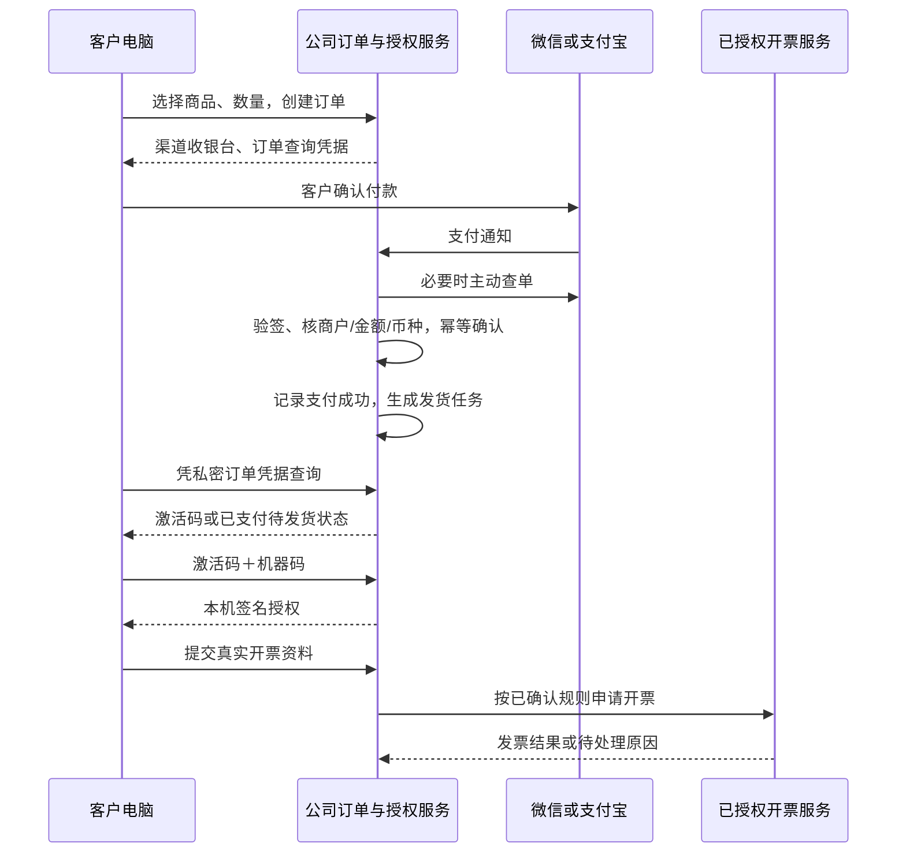

# 公司自营软件：支付、激活与税务接入

核查日期：2026-09-28。本文是产品设计与办理清单，不是商户审核、税务资格认定或已完成申报。真实公司税务记录、银行资料、身份证件、服务器地址及密码保留在企业本地档案，不进入本仓库。

## 1. 已确定的产品规则与实现状态

- 客户无账户、注册或登录。一台机器一份授权，企业采购多台就取得多份独立激活码。
- 全部产品功能付费后开放，无免费编排或试用。未激活只开放授权入口及必要窗口操作。
- 已实现：付费授权、机器绑定、签名验签、激活码加密保存、撤销与受控换机；官网、服务端计价下单、原单恢复、支付宝验签通知及主动查单交付、原机器订阅续费。收款事实与发码分开落库，已收款待交付可查询并按原流水补发。
- 待完成：正式商品及价格确认、受控真实支付和退款验收、微信接入、退款流程、自动开票和财务对账导出。当前凭订单专属凭据恢复；凭据遗失后的身份核实仍需人工处理，没有后台自动重试任务。
- 授权服务、公网 HTTPS、公司支付宝应用身份和通知验签已部署，生产只读查单验签通过；销售开关关闭，未配置正式商品，未发生受控真实收款或开票验收。具体源提交和验证见 [部署记录](COMMERCIAL_DEPLOYMENT.md)；本地测试不代表正式支付或 Windows 验收成功。

逐项网址、材料、操作及完成判定见 [COMMERCIAL_ONBOARDING.md](COMMERCIAL_ONBOARDING.md)。已备案域名不按“每个子域名重新备案”处理，先核对腾讯云接入及主体。

## 2. 办理顺序

| 顺序 | 公司需要做的事 | 取得什么才算完成 |
| --- | --- | --- |
| 1 | 确认实际纳税人资格、税费种、当前发票权限和额度；核对既有办理结果 | 当前电子税务局资格/认定信息及发票状态，不凭公司类型推定 |
| 2 | 确定公司名下域名、网站内容，办理腾讯云接入所需备案 | 有效备案和接入状态，公网 HTTPS 可访问 |
| 3 | 微信支付普通商户进件、开通 Native 支付、绑定适用 AppID | 商户签约完成、产品权限可用、AppID 绑定完成 |
| 4 | 支付宝企业账户实名、开放平台应用及电脑网站支付签约 | 应用上线、收款产品权限可用、接口参数配置完成 |
| 5 | 接入支付、订单发货与退款 | 测试用例通过；获准的受控真实交易、退款及账单核对通过 |
| 6 | 确认软件销售的开票项目、税收分类编码、计税方式；选择适用开票渠道 | 开票规则有依据，企业授权有效，实际蓝字/红字流程核验 |
| 7 | Windows 安装器签名、机器授权及部署恢复测试 | 发行包、付款发货、故障恢复和财务交接均有记录 |

公司的商户和办税账户仍然需要存在；被取消的是本软件客户的注册登录流程。

## 3. 微信支付怎么申请

使用公司主体申请普通商户，自营销售无需先成为为他人接入支付的服务商。进入 [微信支付商户平台](https://pay.weixin.qq.com/)，准备企业营业执照、法定代表人身份证明、经办人信息及公司对公结算账户；依真实软件销售场景填写经营类目、网站及补充资料。提交、身份验证、审核、签约和产品开通分别核验。平台显示的当前类目、结算周期与费率为准。

PC 场景优先使用 Native：服务器创建指定金额订单，客户端/购买网页展示渠道二维码，客户微信扫码付款。它不要求客户注册本软件，也不必先做小程序。商户号与 AppID 是不同标识，需按微信当前要求准备并完成适用 AppID 的关联；不能把 Windows Electron 客户端直接视作 Android/iOS 的 APP 支付产品。[官方 PC 网站接入指引](https://pay.wechatpay.cn/static/applyment_guide/applyment_detail_website.shtml)。

若尚无可用 AppID，建议以公司主体注册并认证微信服务号，再绑定普通商户号；客户扫码付款不需要先关注公众号。不要用未认证账号代替。微信 2026-09-18 更新的 Native 准备文档明确要求公众账号认证并完成商户号绑定，也列出小程序和移动应用等其他可用类型。[Native 开发接入准备](https://pay.wechatpay.cn/doc/v3/merchant/4015614538)。

技术配置包括商户号、AppID、商户 API 证书/私钥、APIv3 密钥、验签所需的微信支付公钥或平台证书，以及回调地址。凭证仅在服务端受限存储，轮换与过期告警需要纳入运营。开发以[微信 Native 官方文档](https://pay.wechatpay.cn/doc/v3/merchant/4012791877)为入口，实施时再核当前接口版本。

## 4. 支付宝怎么申请

使用公司实名的支付宝企业账户，在[支付宝开放平台](https://open.alipay.com/module/webApp)建立“网页/移动应用”，完成基础信息、密钥/证书及网关配置，申请并签约“电脑网站支付”，提交应用审核上线。实际所需营业执照、法人/经办人核验、结算账户、备案网站和售卖内容以商户页面要求为准。

客户端打开受控的浏览器购买页，跳转支付宝官方收银台。客户不需要本软件账户。不要因接口容易调用就将线上软件销售虚报为有线下门店的“当面付”；若以后改为其他产品，先确认商户获批的经营场景覆盖该用途。支付成功页面跳转仅用作展示，发货必须以服务器验签后的支付通知或渠道查单为依据。

密钥和证书模式依获批配置选择，生产与沙箱分离；应用私钥及管理密钥不得放入桌面包。手续费是支付渠道服务成本，不是代公司缴纳增值税或所得税。

## 5. 无账户的自动购买与激活

拟实现流程如下，当前不是已经上线的支付能力：

订单金额由服务器商品价格版本决定，客户端只能提交商品、数量及允许的选项，不能决定最终金额。付款人、软件授权持有人和企业采购方不一定是同一人，订单字段分别记录，开票购买方必须对应真实交易。

查询凭据是高熵秘密；数据库保存其验证用摘要。订单号和机器码都不能单独换取激活码、退款或换机。原设备遗失时通过已验证联系方式/付款凭证等受控恢复；不得公开“任意输入订单号领取授权”。购买后让客户下载订单凭据，邮箱可用于交付与找回，不建设密码账户。

支付通知与主动查单共用幂等逻辑，核对商户、应用、订单号、金额、币种和状态。支付成功、授权发货、激活、退款和发票分别留状态。支付已确认但发码失败时保留“已支付，授权处理中”，通过可恢复任务补发，不要求客户重复付款。重复、乱序、延迟通知不能重复发码；二维码超时后收到真实付款仍须查单处理。

企业批量采购按授权数量发码，无需员工成员系统。对公转账也可使用，但银行流水识别需单独接入获授权渠道；首期保留人工核款作为例外，不能将截图识别称为银行自动确认。

自动交付不等于自动续费扣款。当前按客户主动付款续期规划；未来代扣必须另接渠道授权协议及取消入口，不能仅因用户买过一次就扣下一期。

## 6. 发票如何自动化

数电票资格/额度、支付商户、自动开票 API 是三个不同事项。公司能手动开票，不代表程序已经取得自动开票权限。开票额度也不是免税限额。

适合小规模运营团队的顺序：先在电子税务局确认已开通权限和实际业务编码，再选择支持本企业地区、软件销售场景及红字处理的授权开票服务。可以评估乐企联用/合规服务商接入；不要默认小公司直接取得乐企自用接口，更不能让浏览器脚本绕过人脸验证自动报税。

[税务部门公布的“交易即开票”实践](https://gtm-cn-2r42yzjvn0s.jiangsu.chinatax.gov.cn/art/2026/8/18/art_9000_1774181.html)说明中小商户可通过联用降低接入成本；[上海乐企联用指引](https://shanghai.chinatax.gov.cn/xxgk/tzgg/202601/t479230.html)说明其授权关系。这些资料证明存在该模式，不代表四川本企业已具备权限；接入资格、费用和服务覆盖须向主管税务机关及候选服务商核实。

系统需记录购买方、订单、蓝字发票、累计开票金额、退款与红字单的对应关系。重复点击不能重复开票；资料错误、额度不足或实名核验失效进入待处理队列。电子原件按来源格式留存并防重复归档。退款不能只撤销激活码，还需处理渠道退回、收入调整及必要红字发票；各项成功状态分别确认。

## 7. 税务规则与产品定价

### 先核资格，不能按公司大小猜

增值税小规模、增值税一般纳税人、企业所得税小型微利企业、会计上的小企业会计准则属于不同维度。年应征增值税销售额未超过 500 万元也可能自愿登记一般纳税人；超过标准按规定办理登记，2026 年登记生效及更正规则应单独关注。[增值税法第九条](https://fgk.chinatax.gov.cn/zcfgk/c100009/c5237365/content.html)、[2026 年第 2 号登记公告](https://fgk.chinatax.gov.cn/zcfgk/c100012/c5246538/content.html)。

核验材料：纳税人资格及生效日、有效税费种认定、实际申报周期、计税方式、发票权限和额度。历史操作记录只证明当时状态；“没有找到登记表”不能直接确认未登记。

### 增值税与软件分类

2026—2027 年小规模按期纳税的起征点是月销售额 10 万元或季度 30 万元，按实际计税期间适用；适用交易的 3% 征收率减按 1%。不是“所有公司统一交 1%”。起征点边界按 2026 年规定处理，不照搬旧政策的措辞。软件产品增值税相关现行优惠继续衔接实施，但需满足自身条件。[财政部、税务总局 2026 年第 10 号](https://shanghai.chinatax.gov.cn/zzzb/zcwj/202602/t479283.html)。

未达到起征点也可能因选择放弃免税开具专票而对相应交易纳税；不能给企业客户承诺任何专票需求都不影响税负。[税务总局 2026 年第 4 号](https://fgk.chinatax.gov.cn/zcfgk/c100012/c5247426/content.html)。

本产品是本地安装、机器绑定的桌面软件，不因按年收费就自动成为 SaaS。销售软件产品、软件开发维护服务、无形资产许可等真实交易应按合同、交付及现行税目区分；一般计税下货物与服务可能分别涉及 13% 或 6% 等税率，不能单看营业执照“软件开发”或名称“激活码”直接设置税率。捆绑安装、培训及维护不能为了低税率随意拆分。上线前将标准合同、授权期限、更新服务和交付方式交主管税务机关/会计确认，形成逐商品的开票规则。[增值税法第十、十二、十三条](https://fgk.chinatax.gov.cn/zcfgk/c100009/c5237365/content.html)。

### 收入、费用与所得税

公司直接销售自有软件时，支付手续费通常单列成本费用，不能只按扣费后的银行到账净额记录销售；未开票销售收入也需按适用纳税义务申报。到账、会计收入确认与增值税纳税时点分别核对，尤其是跨期订阅。[税务总局关于漏报未开票收入与扣除佣金的提示](https://www.chinatax.gov.cn/chinatax/n810219/n810780/c5251847/content.html)、[2026 年未开票收入申报答疑](https://shanghai.chinatax.gov.cn/zcfw/rdwd/202605/t480385.html)。

例如订单含税价 1,000 元、渠道扣 6 元、银行结算 994 元：支付账应保留 1,000 元交易与 6 元费用，994 元只是银行结算值。此为说明用假设，不是渠道实际费率，也不是会计收入应计 1,000 元的断言；收入需按计税与履约规则确定。

2023—2027 年，符合条件的小型微利企业按 25% 计算应纳税所得额、适用 20% 税率，折合 5%；条件包括非限制禁止行业、年度应纳税所得额不超过 300 万元、从业人数不超过 300 人、资产总额不超过 5,000 万元。这里的 5% 针对应纳税所得额，不是销售额，也不是本公司已被认定可享受的结论。[税务总局官方答复](https://www.chinatax.gov.cn/chinatax/n810356/n3255681/c5240479/content.html)。

附加税费、工资个税、社保、印花税等按实际业务和认定分别处理。研发加计扣除、软件产品即征即退等需真实项目、人员成本和资格资料，不因为“科技公司”名称自动取得。公司收款不能直接当个人收入随意转出；报销、工资、股东借款及分红分别留凭证并按对应规则处理。

## 8. 服务器、域名与安全

腾讯云中国大陆服务器需要完成适用的域名备案与接入；域名实名认证、备案主体应与公司安排一致。购买页和授权 API 需要公网 HTTPS，支付平台无法向仅 Tailscale 可见的地址回调。管理 API、SSH 和数据库维护保留在 Tailscale 或受控隧道，不把后台令牌交给客户端。[腾讯云备案条件](https://cloud.tencent.com/act/pro/mobile-beian)、[未备案/未接入阻断说明](https://cloud.tencent.cn/document/faq/243/20220)。

ICP备案与增值电信业务许可证不同。仅自营销售、没有其他商家入驻的情形，通信管理部门有无需经营许可证的说明；不能据“收了钱”就认定必须 ICP 经营许可证。具体产品若扩展为有偿信息服务、平台撮合或其他电信业务，需重新判断，四川适用问题向当地通信管理部门确认。[重庆通信管理局自营销售说明](https://cqca.miit.gov.cn/zwgk/tzgg/gggs/art/2023/art_c3383f6983f34280af9f26641256000f.html)。

初期小流量的授权、订单 API 可在 2 核 2GB 单机上先验收；这是工程规划，不是压测结论。下载包放对象存储/CDN，避免 4Mbps 带宽被安装包占满。采用独立服务用户、HTTPS 反代、数据库与密钥异机加密备份、支付发货失败及磁盘告警，演练恢复后再收款。不要将两份 SQLite 文件同时写入当作高可用。

反破解目标是防伪造和增加篡改成本：服务端签名、客户端验签、机器绑定、安全存储、发行包签名与完整性检查。Electron 客户端不能保证绝对不可破解。普通机器哈希不等于硬件证明；使用服务器也不能解决复制系统的问题。密钥不应随安装包分发，用户工程与媒体不因授权而上传或加密锁死。

## 9. 运营日历与自动化边界

| 节奏 | 工作 | 可以自动化的部分 | 仍需处理的例外 |
| --- | --- | --- | --- |
| 每日 | 支付、退款、发货、激活和银行结算核对 | 拉取账单、幂等补发、异常告警 | 金额差异、争议订单、未到账 |
| 每月 | 收集成本费用票据、银行/支付账单、工资资料，关账 | 单据归集、重复检查、凭证及报表草稿 | 业务性质、跨期履约、个人与公司支出区分 |
| 月/季征期 | 按认定提交税费申报和财务报表 | 生成可复核底稿、期限提醒 | 正式申报、身份验证、税款支付与异常更正 |
| 年度 | 所得税汇算、市场监管年报及其他实际义务 | 汇总全年账务、预填资料 | 年度调整、资格条件和提交确认 |

2026 年 10 月，对适用月/季满后 15 日申报规则的税种，申报期限顺延至 10 月 26 日；公司具体应报项目仍以实际认定及应申报清册核对，不把未知项填零。[2026 年申报期限通知](https://fgk.chinatax.gov.cn/zcfgk/c102424/c5245729/content.html)。市场主体通常于每年 1 月 1 日至 6 月 30 日报送上一年度年报，不能把它当成企业所得税申报。[市场主体登记管理条例实施细则第六十三条](https://www.samr.gov.cn/cms_files/filemanager/samr/www/samrnew/samrgkml/nsjg/fgs/202203/W020220302478403609033.pdf)。

“全自动”落在正常订单支付→发货→激活→符合规则的开票→账单归集。实名、人脸、平台签约、争议退款和最终税务申报确认不能假装无需公司负责；本轮不代签、不报税、不扣款，也不保留浏览器或办税密码。

## 10. 上线前的具体交接清单

1. 经营者：确定含税价、授权期限、换机规则、离线周期、售后联系方式和退款政策；准备软件许可协议、隐私说明及企业采购合同。无账户仍需说明机器标识、订单资料的用途、保存期限和访问范围。
2. 商户办理：企业微信商户、适用 AppID、支付宝企业账户与应用、结算信息、获批的支付产品；不要仅记录“申请已提交”。
3. 财税：核实本企业资格、真实软件交易分类、开票字段与额度、税费周期；首批合同和跨期收入规则由会计复核，经营者无需因为自动收款而购买未经验证的无人报税服务。
4. 工程：公网域名/HTTPS、订单凭据、支付验签查单、发货任务、退款状态、开票接口、对账导出与备份恢复。
5. 验收：错金额、伪造/重复/乱序通知、付款后断网、付款成功发货失败、跨机抢码、重复退款、重复开票、红字失败和服务器重启恢复。商户权限未开通前不能把模拟支付称为真实验收。
6. 发布：Windows 实机、签名安装器和更新链、第三方依赖分发义务、产品真实支持范围。销售功能描述不得超过已验收结果。

## 本项目确定的域名

2026-09-28 已选 `api.tuanbo-link.jinhefilm.com` 用于授权与未来支付通知，`updates.tuanbo-link.jinhefilm.com` 用于更新，`tuanbo-link.jinhefilm.com` 预留产品网站。当前没有真实收银台、商户通知路由或网站，不能把 DNS 配置当作商户已开通。部署与多级域名证书方式见 [COMMERCIAL_DEPLOYMENT.md](COMMERCIAL_DEPLOYMENT.md)，预留 API 见 [COMMERCIAL_API.md](COMMERCIAL_API.md)。
