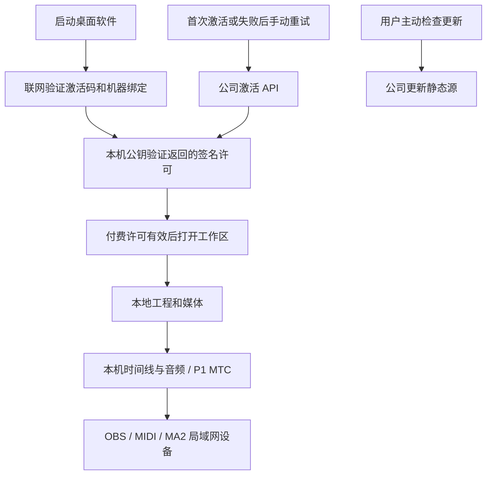

# 源码、版本、部署与本地运行链路

<a id="以后发版本的标准流程"></a>
## 以后发版本的标准流程

用户 2026-10-24 定下：打 tag 即上线，中间没有人工步骤；不做额外的自动化验收，用户自己安装测试；官网只放最新的包。本文后面的章节是 2026-09 的旧链路，以本节和[软件更新文档](SOFTWARE_UPDATES.md#步骤)为准。

1. 发布提交只改根目录和 `apps/desktop` 两个 `package.json` 的版本号，提交信息 `chore(release): X.Y.Z`，推 master。
2. 这个提交的 CI 通过后，在它上面打 `vX.Y.Z` 标签并推送。
3. 之后全部自动（2026-10-24 用户定下：在 GitHub 云端打包，工位电脑只负责把包搬到服务器；不用 Cloudflare）：
   - Release Windows 的 verify 和 build 作业在 GitHub 云端 Windows 上跑：检查版本、类型、单测、lint；下载美颜和音乐分析的固定资产，打包、签名，把四个文件放进这个标签的草稿 GitHub Release。
   - transfer 作业在工位电脑的 runner 上跑：下载草稿、按构建清单核对，上传到服务器 staging。
   - 服务器：发布脚本重新做全部校验（签名、manifest、sha256、版本高于更新源、这个版本没发布过），通过就上线。
   - transfer 作业等更新源换成这个版本，把草稿转为正式 Release，标为 Latest。
   - 工位电脑关机时，transfer 作业排队等它开机；排队超时后在 Actions 里只重跑这个作业。
4. 用户从官网下载安装、测试。有问题就在后台「回滚到上一版」，或者修好后发下一个版本。

后台「软件更新」保留，用来看状态、看最近一次自动发布的结果和紧急回滚。没能自动发布的版本留在待发布列表里，原因写在「最近一次自动发布」。

官网下载信息暂时还要在上线后运行 `node scripts/write-website-release.mjs` 并推送；改成直接跟着更新源变化之后，这一步去掉。

保留规则：
- 官网下载页和 `release.json` 只放最新版。
- 更新源只放最新版和它替换掉的上一版：上一版的安装包供一步回滚，上一版的 blockmap 供从它升级的电脑做差分。
- 再往前的版本，发布成功时由服务器发布脚本移进 root 的备份目录，不删除，也不对外提供。
- 回滚到上一版时，撤下的版本同样移出更新源；回滚后更新源只剩回到的那个版本。
- GitHub Releases 保留所有版本。

<a id="发版流程待办"></a>
待办（2026-10-24 记录，暂不实现）：
- **服务器磁盘**：总共 49 GB，当时剩 34 GB。每发一个版本，`/var/backups/tblink` 就多一份约 1 GB 的归档；staging 另外最多存 5 份，每份约 1 GB。照这样发二三十个版本后磁盘会紧张。
- **只保留最近 3 份归档**：GitHub Releases 已保留全部版本，服务器上的归档只是冗余，所以发布脚本只保留最近 3 份归档，更早的移除。
- **磁盘余量提示**：后台「软件更新」显示服务器剩余空间。剩余空间低于 5 GB 时，发布前就拒绝，并写明原因。

0.5.0 的例外（2026-10-24）：构建机上的 Actions runner 还没注册，0.5.0 由会话在构建机上按 Release Windows 的步骤手动完成：
- 来源：CI 全部通过的 master 提交 `37a4334864cf6f0c219c8c37523e90ed6341998d`，干净检出在 `C:\dev\tblink-release`。
- 检查和打包：版本检查、`pnpm verify`；复制固定版本的美颜和音乐分析产物后 `pnpm dist`，再 `node scripts/verify-desktop-artifacts.mjs --dist`。
- 签名：用 release-2026-10-a 签 `latest.yml`，写 `release-manifest.json`（0 项失败）。安装包 sha256 `8266abaf6ad45d2bfad995823f0d478457d3ec0acdcc0bbcbb2fea3091e80087`，987,697,473 字节。产物另存在构建机 `D:\tblink-release-scratch\release-0.5.0\`。
- 上传：以 tblink-release 身份上传 staging 时卡住。构建机到服务器的路径 MTU 约 1492，1500 字节的包被丢弃且没有 ICMP 提示，满尺寸 TCP 段发不出去；下载方向不受影响。构建机上的 Release Windows 也会遇到同样的问题，要先在构建机上把网卡 MTU 调低（或在路由器上钳制 MSS）。
- 由主会话在服务器上用 `publish-update.py` 的手动模式发布。
- v0.5.0 的 GitHub Release 由会话在上线后补建：在构建机上用最新 master 的 `scripts/publish-github-release.mjs 0.5.0 D:\tblink-release-scratch\release-0.5.0`。先确认 `gh api user --jq .login` 是 Fldicoahkiin，再设 `GITHUB_REPOSITORY=Fldicoahkiin/tuanbo-link-console`，`GITHUB_TOKEN` 取 `gh auth token`。脚本用这个 token 建 `v0.5.0` 标签，会触发一次 Release Windows：它的检查作业会以「不高于线上更新源」失败，不会构建。这次失败是预期的。

2026-09-30 当前生产状态：Windows **0.4.29** 已正式发行，公司更新源已发布安装包、blockmap 与 `latest.yml`；官网已开放支付宝月付 **800 元／30 天／台**、年付 **8,000 元／365 天／台**。已核验未付款订单创建、同单恢复和未付款不发码，未进行实际扣款。Windows CI 已通过正式安装版无凭证拦截、覆盖安装与卸载验收，见[专项记录](LICENSE_UPDATE_ACCEPTANCE.md)；真实支付交付与续费、退款及两版本重启更新仍待真人测试；微信 Native 服务端及官网已部署、商户凭据未配置且收款关闭；自动开票尚未接入。实际构建、摘要与部署备份见 [发行记录](RELEASE_0.4.29.md)。下文带日期的旧关闭／未发行记录只表示当时状态。

初始审查记录（2026-09-28，非当前状态）：当时基于工作区代码、Git 配置及服务器部署验收记录，不代表已发布新的 Windows 安装包。当时受限环境的 GitHub CLI 身份核查返回 HTTP 401，未取得远端最新分支、Actions 或 Release 状态；`origin/master` 只是本地跟踪引用，不能当作实时远端状态。

## 1. 运行位置与职责

| 位置 | 职责 | 不应承担的工作 |
| --- | --- | --- |
| GitHub `Fldicoahkiin/tuanbo-link-console` | 源码、锁文件、构建脚本、版本标签、CI 与候选产物归档 | 保存生产许可私钥、数据库、支付密钥或客户工程 |
| GitHub Actions Windows runner / 受控 Windows 构建机 | 构建 Windows DLL/EXE、Electron、NSIS；测试、签名和产物清单 | 连接真实直播现场并替代人工设备验收 |
| 腾讯云 Ubuntu `jinhe-cloud` | HTTPS、更新文件出口、激活/订单服务及后续支付回调 | 运行客户桌面界面、播放时间线或代替 Windows 原生构建环境 |
| 客户 Windows 电脑 | 工程、媒体、音频、时间线、Cue、MIDI、OBS/MA2 联动、本地许可校验 | 持有仓库访问令牌、服务管理员令牌或任何发行私钥 |

“软件离线运行”不要求把软件界面部署到服务器。服务器上的发布职责是保存和分发构建产物；激活、订单与后续支付则是另一条服务链。若保留在线购买及自动交付，服务器不能只有安装包目录。

当前原生构建脚本 `tools/obs/native-preview/build.mjs` 和 `tools/midi-probe/build.mjs` 明确拒绝非 Windows；发布 manifest 和安装验收也要求 Windows。不能把当前 2 核 / 2GB Ubuntu 改成跑完整 Windows 打包，并声称与原生验收等价。构建机由 GitHub 托管也属于服务器构建，不占用客户电脑。

## 2. 开发到客户安装


图中 GitHub → 腾讯云同步阶段尚未实现。现有 workflow 只上传 GitHub 资产；公司 feed 不会自动读取 GitHub Release，也不会因仓库提交或版本号变化自动更新。

本轮将现有标签流水线改为草稿 Release（`draft: true`、不标记 Latest），因为当前构建仍明确要求未签名候选产物。草稿是内部候选归档，不是商业上线。2026-09-29 用户授权 0.4.29 先发行后实测，本次 feed 接收已核验摘要的未签名安装包，保留 NotSigned 状态。后续签名发行要求：签名需要在生成摘要、blockmap 和 manifest 之前完成，不能给旧包补签后继续用旧摘要。

本轮已修复一个发布阻断：`verify-desktop-artifacts.mjs` 原本仍要求 `provider: github` 和旧仓库，而桌面配置已经使用 `generic` 公司源。现在解析包内 YAML，严格比较 `apps/desktop/package.json` 中的 provider/url，并拒绝错误源、重复键及访问凭据。

官方行为依据：[GitHub 标签推送触发](https://docs.github.com/en/actions/reference/workflows-and-actions/events-that-trigger-workflows#push)、[草稿 Release action 配置](https://github.com/softprops/action-gh-release)。实际脚本以仓库版本为准。

## 3. 版本与 Git 规则

| 对象 | 版本标识 | 规则 |
| --- | --- | --- |
| Windows 产品 | 当前根包和桌面包均为 `0.4.29` | 两处必须一致；升级用递增 `X.Y.Z`，不移动失败的旧标签 |
| 自动构建标签 | `vX.Y.Z` | 必须与两个 package 版本一致；禁止移动已发布标签 |
| 历史快照标签 | `desktop-*` | 当前本地有此类标签，但不匹配 CI 的 `v*` 触发条件，不等于已发布版本 |
| 安装包 | 文件名含版本与 `x64` | 相同文件名内容不可覆盖；坏版本发布更高补丁版本修复 |
| 服务端部署 | Git 完整 SHA + 构建文件 SHA-256 | 可独立升级，不因服务修复强制修改桌面版号 |
| 工程格式 | `.tblink` schema v1 / 灯光 v2 | 与产品版本分开，不因每次发布修改 schema |
| 授权协议/签名密钥 | 协议版本及 keyId | 不跟随产品小版本随意重签或删旧公钥 |
| 原生组件 | 本次构建产物与对应源码 | 随安装包归档并核验，不在客户电脑临时下载编译器 |

生产分支为 `master`，本次源码与工作流已推送；早期审查时的“领先 9 个提交、未推送”属于历史状态。不要根据旧资料将生产分支假定为 `main`。服务端自动部署步骤和受限服务器接收器已准备，仓库 Secrets 与启用变量尚未配置；目前提交仍不会自动改变生产，见 [自动发布状态与权限](AUTOMATED_DEPLOYMENT.md)。

开发提交使用 Conventional Commits，按独立可回退的变更拆分。一次提交不等于一个产品版本；集中验收后再提升版号和创建发布标签。普通 bug 修复增加 PATCH，向后兼容新功能增加 MINOR，不兼容变化需写明迁移策略，不能靠版本数字代替兼容检查。

日常检查：

```sh
pnpm release:check
pnpm test:release
git status --short
git log -5 --oneline
```

准备某个真实发行版本时，先同步根包和桌面包 version，提交后执行 `pnpm release:check vX.Y.Z`。确认该版本与标签未使用，再在获准发布时创建标签并推送；这份文档不是自动 push 授权。现已推送源码、创建版本标签并运行原生 Windows 流水线；各次结果见发行记录。

Windows 上执行 `pnpm verify:release`，再执行 `pnpm verify:installer` 和相关设备/更新验收。当前工作流运行前者，不运行后者；CI 成功不等于安装生命周期和 OBS/MA2 设备均已验收。

## 4. 服务器怎样与 Git 对应

服务器部署构建产物，不需要在公网站点目录放完整 Git checkout。不要在 `/srv/tblink-updates` 中保存 `.git`、源码包或仓库令牌。现有源站按白名单提供正式更新文件。

2026-09-30 授权服务和官网来源均为 `fb6e286c4a9c700b9693d566389598ace3ad446d`；systemd 运行 `/opt/tblink-licensing/dist/index.js`。部署已记录 `/opt/tblink-licensing/RELEASE`、bundle SHA-256、受限备份与部署回执，并执行 SQLite 副本恢复及数据一致性核对，详情见部署文档。付款链接、主动查单、商品目录、自助下单、原机器续费和独立收款记录／补交付已经部署，代理来源按客户分别限流；支付宝商户身份和验签配置已完成，支付宝目录与收款开关已于 2026-09-29 启用；微信 Native 代码已部署但尚未配置商户凭据，微信收款保持关闭。受限发布工作流已准备，但仓库开关与密钥尚未启用，生产仍由手动发布管理。

以下自动部署要求已落实为条件工作流及受限接收器，但尚未启用或完成 GitHub 到生产的端到端验证；具体状态见 [自动发布说明](AUTOMATED_DEPLOYMENT.md)：

1. 构建绑定不可变 commit SHA，锁文件安装，验证后生成产物摘要；服务包仅含运行所需 JS、`type: module` 的 package.json 和部署回执。
2. 通过专用受限部署身份上传；服务器登录密码不写进 YAML，不把管理员激活令牌当作发布令牌。GitHub SSH 主机指纹需固定核验。
3. 更新包先写临时目录、验证长度和摘要，再发布版本化文件；最后同目录原子替换 `latest.yml`。失败时保留旧清单和旧文件。
4. 服务端另走受控部署步骤：备份、数据库兼容性检查、部署、重启授权服务、健康与接口边界探测。静态更新发布不能重启授权服务或 Nginx。
5. 每次留下回执：Git SHA、CI run、产品/服务版本、构建摘要、部署时间、上一个版本、验证结果。回执保存在非公开目录；对外版本状态仅暴露必要信息。
6. 回退软件更新时撤回最新清单能阻止后续下载，不能让已经安装的客户端自动降级。服务端回退必须同时评估数据库格式；不能只恢复 JS 而忽略已迁移数据。

GitHub 身份和 master 分支已核实并使用；尚需配置或核对：分支保护规则、Windows 签名设施、受限发布身份、GitHub 到腾讯云的传输通道及发布审批。当前生产配置与密钥不会因为本地提交被自动覆盖。已有 HTTPS 验收见 [部署交接](COMMERCIAL_DEPLOYMENT.md)。

## 5. 本地运行与每次启动联网校验



节目编排、音频、时间码和 Cue 不经过公司服务器；用户配置的 OBS/MA2 仍可能使用本机或局域网网络。OBS 浏览器来源等用户自选远程内容也可能自行依赖互联网，不能将此归为公司的云计算服务。

2026-09-28 用户已澄清：采用每次启动联网检测授权。当前源码每次进程启动，在工作区和设备适配器挂载前通过固定 HTTPS API 验证激活码和机器绑定；并发调用只触发一次请求。失败时保持激活页，不回退缓存、不自动重试；支持用户手动重试。激活码仅通过安全存储读取，不需要客户注册账户。

签名凭证仍最多七天，作为本次会话的本地期限，不代表允许七天内断网重新启动。已经开始的演出继续运行，无后台定时轮询；停止后重新检查本地许可。正式客户端拒绝导入离线文件绕过在线校验，历史协议与旧客户端的既有能力不因此改变。服务端接口未变化，本次无需部署服务器；新行为需发布新客户端才生效。

这不是即时远程强制下线：已通过启动校验的会话不会后台获知撤销，迁移等待旧租约的现有服务规则保持不变。

`updatesUntil` 当前只是保存和展示，尚未限制新版本使用资格。付费升级的版本门槛不能靠更新下载链接保密实现；新客户端本身也须校验授权所允许的升级范围。

## 6. 当前完成度与下一步

| 链路 | 已有 | 剩余 |
| --- | --- | --- |
| 源码管理 | GitHub origin、本地提交、锁文件；2026-09-29 已核对身份、远端 master 和仓库权限 | 源码已推送；分支保护规则尚未核对 |
| 候选构建 | Windows 标签工作流、手动指定提交的候选构建、版本一致性检查、草稿 Release | Windows verify:release 及正式安装器生命周期已通过；真实付费激活与设备验收待完成 |
| 正式发行 | 0.4.29 正式 Release、NSIS、摘要与 manifest | Authenticode 签名、发布者校验、当前 unsigned-only 门槛改造 |
| 公司更新出口 | CF DNS、TLS、静态目录、续期验收 | 0.4.29 安装包及 feed 已发布；产物自动同步和两版本实机更新待完成 |
| 付费与激活 | 人工核款发码、绑定机器、签名凭证、每次启动联网校验；数据库备份副本恢复已验收 | 异地密钥备份与整机恢复、正式 Windows 激活验收 |
| 自动销售 | 支付通知/领取、运营付款链接、主动查单补交付 API 已部署；公司支付宝及电脑网站支付已开通；商品计价与自助下单已启用；桌面购买/恢复/领码随 0.4.29 发布 | 经营材料补件；Windows 桌面验收、发票 API、退款对账及真实支付验收 |
| 现场运行 | 本机编排、OBS/MIDI/MA2 适配 | 现场设备与长时间运行验收不能被构建成功替代 |

本轮验证：先复现旧更新源检查拒绝当前 generic 配置，再通过五项脚本回归、版本检查、定向 ESLint 与 JavaScript 语法检查。当前主机为 macOS，没有执行 Windows `verify:release`、安装、签名或实机更新。更没有将草稿、单测或 TLS 通过写成全链路商业可交付。

本次启动校验变更验证：授权与服务端专项 20 项、浏览器真实组件配测试桥 5 项通过；类型检查、Lint 和 Electron main/preload/renderer 构建通过。浏览器断网/撤销为模拟边界数据，不替代正式 Windows 安装和生产授权服务联调。


## 7. 手动 Windows 构建与草稿归档

同一 `release-windows.yml` 支持 `workflow_dispatch`。运行者必须填写完整小写 40 位 `expected_sha`，checkout 直接检出该提交，并比较实际 HEAD。工作流可从 master 运行而产品源码保持固定标签；GitHub run 的 headSha 标识工作流来源，不能代替 manifest 的产品 gitSha。输入经环境变量传入 PowerShell，不插入命令源码。

手动路径运行现有 `pnpm verify:release`，不要求新建产品版本标签。成功后把安装器、blockmap、latest.yml 和 release-manifest.json 保存为当前 run 的候选 artifact，名称包含提交、run ID 和 attempt，保留 14 天。构建作业具有 contents:write 以支持直接草稿归档，checkout 不持久化 GitHub 凭据。默认候选仍使用 artifact；v 标签 push 成功时由独立作业下载同一次构建产物并创建草稿 Release，保持 draft=true、make_latest=false。

手动运行默认不创建 Release。只有显式 `archive_to_draft=true` 时，构建完成后才用 GitHub API 核对既有版本标签与 manifest SHA 一致，直接将四个分发文件上传为草稿 Release；这一路不使用 Actions artifact 配额，不覆盖已有 Release，不部署腾讯云或写正式 feed。正式公开仍是后续单独操作。现有 manifest 如实要求未签名候选；本次先发行后实测的授权与证据见 [0.4.29 记录](RELEASE_0.4.29.md)。

2026-09-29 首次同步前的历史记录：已在本机执行环境核对 `gh api user --jq .login` 为 `Fldicoahkiin`；仓库为私有，默认分支为 `master`，当前账号有 pull/push 权限、无 admin 权限。实际 fetch 后远端 `master` 为 `fb9b59e`，相对当时本地 `14eaac7` 无远端独有提交、本地领先 46 个提交。本次没有 push 或触发工作流。受限执行环境曾返回 401，而同机环境读取成功，不能据前者要求用户反复重新登录。后续 GitHub 写入前仍重新核对身份及分支状态。

现已获得推送与发行授权，源码及工作流已推送。GitHub 要求支持 workflow_dispatch 的工作流存在于默认分支；未推送的本地 YAML 不能远程运行。实际调用模板：

```sh
gh workflow run release-windows.yml --repo Fldicoahkiin/tuanbo-link-console --ref <已核对分支> -f expected_sha=<完整提交SHA>
```

触发后记录真实 run ID，分别核对工作流 headSha、实际产品 checkout SHA、结论及对应 manifest，不能仅凭触发命令成功声称 Windows 通过。核对来源与产物后，才安排受控 Windows 安装／激活／更新验收。官方依据：[手动运行工作流](https://docs.github.com/en/actions/how-tos/manage-workflow-runs/manually-run-a-workflow)、[工作流产物及跨作业传递](https://docs.github.com/en/actions/tutorials/store-and-share-data)。

早期候选准备验证（非最新远端结果）：actionlint 1.7.12 工作流检查通过，YAML 解析及手动／标签发布边界核对通过，`pnpm test:release` 五项通过、`pnpm release:check` 确認根包与桌面包均为 0.4.27。没有运行远端工作流，没有生成新的 Windows 成品。

2026-09-29 直接草稿归档修复：actionlint 1.7.12 与 YAML 解析通过。第一次 0.4.29 Windows `verify:release` 已通过，因 artifact 配额耗尽未能归档；已使用原产品 SHA 重新运行直接草稿归档。最新结论以 [发行记录](RELEASE_0.4.29.md) 为准。
