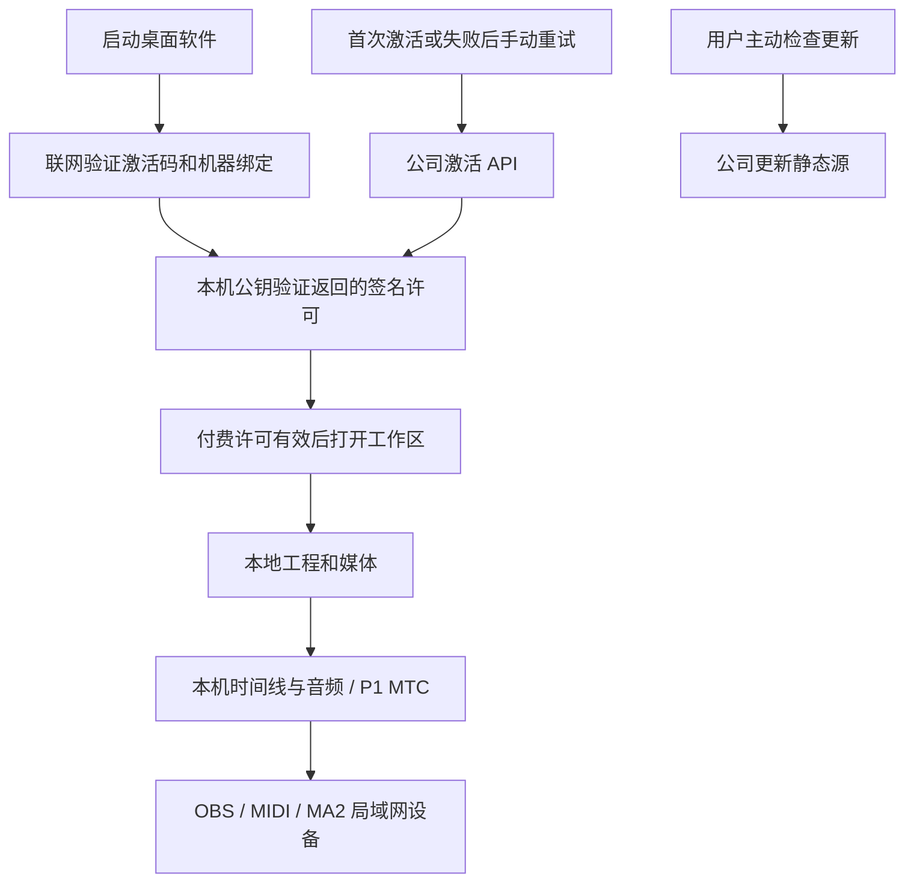

# 源码、版本、部署与本地运行链路

核查日期：2026-09-28。本轮基于工作区代码、Git 配置及服务器部署验收记录，不代表已发布新的 Windows 安装包。最初链路核查时 GitHub CLI 返回 HTTP 401；这只是当时的认证结果。本节未重新取得团播远端最新分支、Actions 或 Release 状态，`origin/master` 不能当作实时远端状态。

## 1. 运行位置与职责

| 位置 | 职责 | 不应承担的工作 |
| --- | --- | --- |
| GitHub `JinHe9527/tuanbo-link-console` | 源码、锁文件、构建脚本、版本标签、CI 与候选产物归档 | 保存生产许可私钥、数据库、支付密钥或客户工程 |
| GitHub Actions Windows runner / 受控 Windows 构建机 | 构建 Windows DLL/EXE、Electron、NSIS；测试、签名和产物清单 | 连接真实直播现场并替代人工设备验收 |
| 腾讯云 Ubuntu `jinhe-cloud` | HTTPS、更新文件出口、激活/订单服务及后续支付回调 | 运行客户桌面界面、播放时间线或代替 Windows 原生构建环境 |
| 客户 Windows 电脑 | 工程、媒体、音频、时间线、Cue、MIDI、OBS/MA2 联动、本地许可校验 | 持有仓库访问令牌、服务管理员令牌或任何发行私钥 |

“软件离线运行”不要求把软件界面部署到服务器。服务器上的发布职责是保存和分发构建产物；激活、订单与后续支付则是另一条服务链。若保留在线购买及自动交付，服务器不能只有安装包目录。

当前原生构建脚本 `tools/obs/native-preview/build.mjs` 和 `tools/midi-probe/build.mjs` 明确拒绝非 Windows；发布 manifest 和安装验收也要求 Windows。不能把当前 2 核 / 2GB Ubuntu 改成跑完整 Windows 打包，并声称与原生验收等价。构建机由 GitHub 托管也属于服务器构建，不占用客户电脑。

## 2. 开发到客户安装


图中 GitHub → 腾讯云同步阶段尚未实现。现有 workflow 只上传 GitHub 资产；公司 feed 不会自动读取 GitHub Release，也不会因仓库提交或版本号变化自动更新。

本轮将现有标签流水线改为草稿 Release（`draft: true`、不标记 Latest），因为当前构建仍明确要求未签名候选产物。草稿是内部候选归档，不是商业上线。正式 feed 只接收验收通过的签名安装包；签名需要在生成摘要、blockmap 和 manifest 之前完成，不能给旧包补签后继续用旧摘要。

本轮已修复一个发布阻断：`verify-desktop-artifacts.mjs` 原本仍要求 `provider: github` 和旧仓库，而桌面配置已经使用 `generic` 公司源。现在解析包内 YAML，严格比较 `apps/desktop/package.json` 中的 provider/url，并拒绝错误源、重复键及访问凭据。

官方行为依据：[GitHub 标签推送触发](https://docs.github.com/en/actions/reference/workflows-and-actions/events-that-trigger-workflows#push)、[草稿 Release action 配置](https://github.com/softprops/action-gh-release)。实际脚本以仓库版本为准。

## 3. 版本与 Git 规则

| 对象 | 版本标识 | 规则 |
| --- | --- | --- |
| Windows 产品 | 当前根包和桌面包均为 `0.4.27` | 两处必须一致；升级用递增 `X.Y.Z`，本轮未提升产品版本 |
| 自动构建标签 | `vX.Y.Z` | 必须与两个 package 版本一致；禁止移动已发布标签 |
| 历史快照标签 | `desktop-*` | 当前本地有此类标签，但不匹配 CI 的 `v*` 触发条件，不等于已发布版本 |
| 安装包 | 文件名含版本与 `x64` | 相同文件名内容不可覆盖；坏版本发布更高补丁版本修复 |
| 服务端部署 | Git 完整 SHA + 构建文件 SHA-256 | 可独立升级，不因服务修复强制修改桌面版号 |
| 工程格式 | `.tblink` schema v1 / 灯光 v2 | 与产品版本分开，不因每次发布修改 schema |
| 授权协议/签名密钥 | 协议版本及 keyId | 不跟随产品小版本随意重签或删旧公钥 |
| 原生组件 | 本次构建产物与对应源码 | 随安装包归档并核验，不在客户电脑临时下载编译器 |

本地分支目前为 `master`；开始本轮时比本地 `origin/master` 多 9 个提交，尚未 push。不要根据旧资料将生产分支假定为 `main`。服务端当前没有从某个 Git 分支自动部署。

开发提交使用 Conventional Commits，按独立可回退的变更拆分。一次提交不等于一个产品版本；集中验收后再提升版号和创建发布标签。普通 bug 修复增加 PATCH，向后兼容新功能增加 MINOR，不兼容变化需写明迁移策略，不能靠版本数字代替兼容检查。

日常检查：

```sh
pnpm release:check
pnpm test:release
git status --short
git log -5 --oneline
```

准备某个真实发行版本时，先同步根包和桌面包 version，提交后执行 `pnpm release:check vX.Y.Z`。确认该版本与标签未使用，再在获准发布时创建标签并推送；这份文档不是自动 push 授权。本轮未打新标签、未 push、未运行远端流水线。

Windows 上执行 `pnpm verify:release`，再执行 `pnpm verify:installer` 和相关设备/更新验收。当前工作流运行前者，不运行后者；CI 成功不等于安装生命周期和 OBS/MA2 设备均已验收。

## 4. 服务器怎样与 Git 对应

服务器部署构建产物，不需要在公网站点目录放完整 Git checkout。不要在 `/srv/tblink-updates` 中保存 `.git`、源码包或仓库令牌。现有源站按白名单提供正式更新文件。

最近已验收的生产部署为 `e032891a10d1f41124e850a83a238e5ea40def45`，systemd 运行 `/opt/tblink-licensing/dist/index.js`。部署已记录 `/opt/tblink-licensing/RELEASE`、bundle SHA-256、受限备份与部署回执，并执行 SQLite 副本恢复及数据一致性核对，详情见部署文档。付款链接、主动查单、商品目录及自助下单已经部署，代理来源按客户分别限流；商户身份和密钥未配置，目录与收款开关关闭。仍没有自动部署 workflow 或自动跟随主分支。

后续接入自动部署应明确以下流程：

1. 构建绑定不可变 commit SHA，锁文件安装，验证后生成产物摘要；服务包仅含运行所需 JS、`type: module` 的 package.json 和部署回执。
2. 通过专用受限部署身份上传；服务器登录密码不写进 YAML，不把管理员激活令牌当作发布令牌。GitHub SSH 主机指纹需固定核验。
3. 更新包先写临时目录、验证长度和摘要，再发布版本化文件；最后同目录原子替换 `latest.yml`。失败时保留旧清单和旧文件。
4. 服务端另走受控部署步骤：备份、数据库兼容性检查、部署、重启授权服务、健康与接口边界探测。静态更新发布不能重启授权服务或 Nginx。
5. 每次留下回执：Git SHA、CI run、产品/服务版本、构建摘要、部署时间、上一个版本、验证结果。回执保存在非公开目录；对外版本状态仅暴露必要信息。
6. 回退软件更新时撤回最新清单能阻止后续下载，不能让已经安装的客户端自动降级。服务端回退必须同时评估数据库格式；不能只恢复 JS 而忽略已迁移数据。

尚需配置：GitHub 有效身份、实际远端生产分支和保护规则、Windows 签名设施、受限发布身份、GitHub 到腾讯云的传输通道及发布审批。当前生产配置与密钥不会因为本地提交被自动覆盖。已有 HTTPS 验收见 [部署交接](COMMERCIAL_DEPLOYMENT.md)。

## 5. 本地运行与每次启动联网校验



节目编排、音频、时间码和 Cue 不经过公司服务器；用户配置的 OBS/MA2 仍可能使用本机或局域网网络。OBS 浏览器来源等用户自选远程内容也可能自行依赖互联网，不能将此归为公司的云计算服务。

2026-09-28 用户已澄清：采用每次启动联网检测授权。当前源码每次进程启动，在工作区和设备适配器挂载前通过固定 HTTPS API 验证激活码和机器绑定；并发调用只触发一次请求。失败时保持激活页，不回退缓存、不自动重试；支持用户手动重试。激活码仅通过安全存储读取，不需要客户注册账户。

签名凭证仍最多七天，作为本次会话的本地期限，不代表允许七天内断网重新启动。已经开始的演出继续运行，无后台定时轮询；停止后重新检查本地许可。正式客户端拒绝导入离线文件绕过在线校验，历史协议与旧客户端的既有能力不因此改变。服务端接口未变化，本次无需部署服务器；新行为需发布新客户端才生效。

这不是即时远程强制下线：已通过启动校验的会话不会后台获知撤销，迁移等待旧租约的现有服务规则保持不变。

`updatesUntil` 当前只是保存和展示，尚未限制新版本使用资格。付费升级的版本门槛不能靠更新下载链接保密实现；新客户端本身也须校验授权所允许的升级范围。

## 6. 当前完成度与下一步

| 链路 | 已有 | 剩余 |
| --- | --- | --- |
| 源码管理 | GitHub origin、本地提交、锁文件 | 团播远端最新状态和保护规则未重新核实，未 push |
| 候选构建 | Windows 标签工作流、版本一致性检查、草稿 Release | 本轮未运行远端 CI；无完整 Windows 构建验收 |
| 正式发行 | NSIS、摘要与 manifest 脚本 | Authenticode 签名、发布者校验、当前 unsigned-only 门槛改造 |
| 公司更新出口 | CF DNS、TLS、静态目录、续期验收 | 首个可信安装包、产物自动同步、两版本实机更新 |
| 付费与激活 | 人工核款发码、绑定机器、签名凭证、每次启动联网校验；数据库备份副本恢复已验收 | 异地密钥备份与整机恢复、正式 Windows 激活验收 |
| 自动销售 | 支付通知/领取、运营付款链接、主动查单补交付 API 已部署；公司支付宝及电脑网站支付已开通；商品计价与自助下单已部署但销售关闭；桌面购买/恢复/领码尚未发布 | 开放平台应用和密钥、正式定价；Windows 桌面验收、发票 API、退款对账及真实支付验收 |
| 现场运行 | 本机编排、OBS/MIDI/MA2 适配 | 现场设备与长时间运行验收不能被构建成功替代 |

本轮验证：先复现旧更新源检查拒绝当前 generic 配置，再通过五项脚本回归、版本检查、定向 ESLint 与 JavaScript 语法检查。当前主机为 macOS，没有执行 Windows `verify:release`、安装、签名或实机更新。更没有将草稿、单测或 TLS 通过写成全链路商业可交付。

本次启动校验变更验证：授权与服务端专项 20 项、浏览器真实组件配测试桥 5 项通过；类型检查、Lint 和 Electron main/preload/renderer 构建通过。浏览器断网/撤销为模拟边界数据，不替代正式 Windows 安装和生产授权服务联调。
