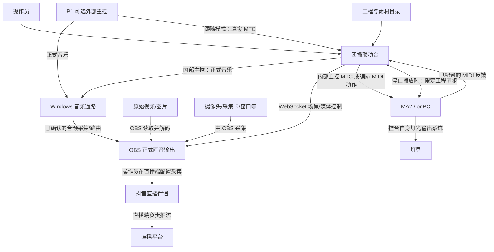
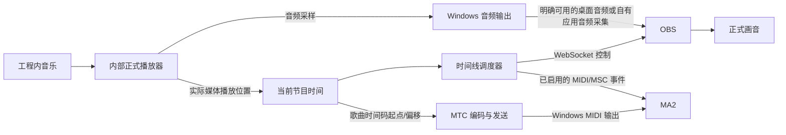
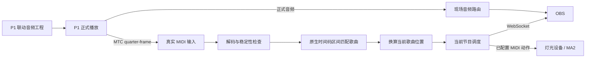
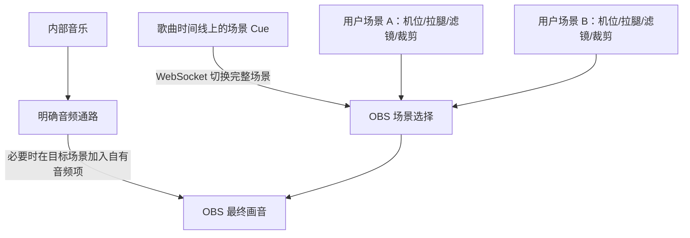
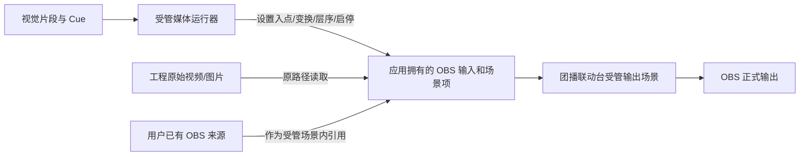
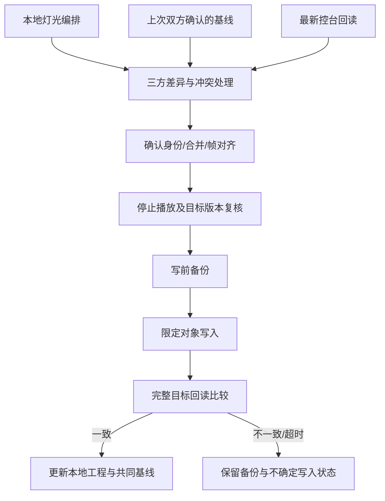
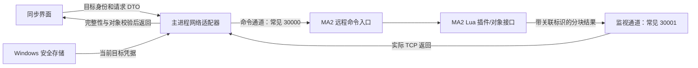
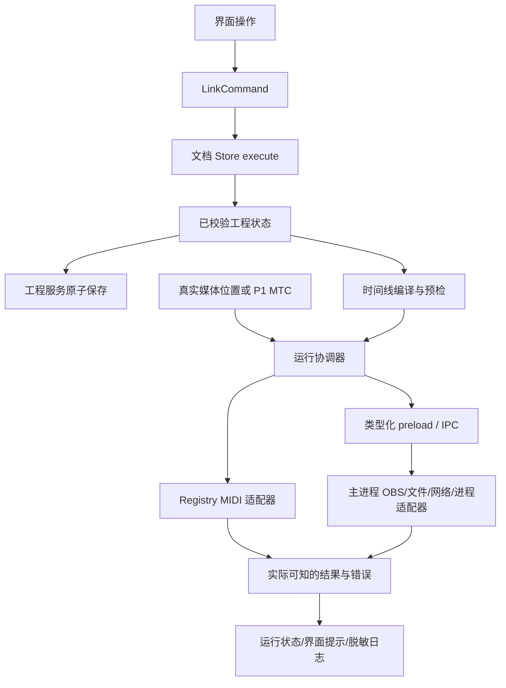

# 团播联动台：系统原理与拓扑说明

> 这是 0.4.1（2026-09-11）时的说明，只作记录：现场接线和四种数据的区分仍然有用，软件内部的结构已经变了（演出现在在主进程里跑）。现在的结构见 [ARCHITECTURE.md](./ARCHITECTURE.md)，规则见 [AGENTS.md](../AGENTS.md)；不一致时以它们和代码为准。

日期：2026-09-11  
基准：当前 0.4.1 源码及实施记录  
用途：理解系统工作原理、现场接线、数据方向与故障边界。

配套文档：[当前功能及使用说明](当前功能及使用说明.md)、[软件开发策划说明书（详细版）](软件开发策划说明书（详细版）.md)。

## 1. 总体原理

系统以歌曲位置为时间基准，把时间线上的事件发送给 OBS 和灯光设备。联动台负责“什么时候做什么”，OBS 负责正式画面与音频输出，MA2 负责灯光 Cue 的实际执行。

四种数据必须区分：

| 数据 | 作用 | 是否包含声音/画面 |
| --- | --- | --- |
| 正式音频/视频 | 观众实际看到、听到的内容 | 是 |
| MTC 时间码 | 告诉接收方当前处于哪个时间位置 | 否 |
| 控制指令 | 切场景、播放媒体、触发 Cue、改变控制值 | 否 |
| 工程同步数据 | 编辑和交换 Timecode、轨道、事件、绑定与基线 | 否 |

MTC 不是音乐，也不是灯光 Cue 内容；网络同步成功不代表音乐正在播放；MIDI 发送完成不代表控台已经执行。

### 总体拓扑



图中同时列出了两种音乐来源，实际运行时明确选择内部主控或 P1 跟随，不由软件自动混合或断线切换。MA2 到灯具、OBS 到直播伴侣的具体物理/软件路由由现场配置，联动台不创建自己的视频输出或推流通路。

## 2. 内部音乐主控拓扑

### 信号链



### 工作步骤

1. 播放前验证歌曲、素材、所需端口、OBS 目标和音频通路。
2. 音乐解码器开始正式播放，真实播放位置成为节目时钟。
3. 调度器按时间跨越检查到期 Cue 和片段开始/结束。
4. 画面事件发给 OBS；已启用的灯光事件发给 MIDI 输出。
5. 需要控台 Timecode 跟随时，将歌曲位置叠加歌曲起点/偏移，编码为 MTC。
6. 暂停、定位、停止或切歌时，取消旧调度并处理活动音符与受管媒体。

显示波形、倒计时或动画的刷新不能独立推进正式 Cue。音频不推进时，软件不能用界面计时器继续跑节目。

### 两种灯光执行方式

| 方式 | 联动台发什么 | MA2 做什么 |
| --- | --- | --- |
| 控台 Timecode 跟随 | MTC 时间位置 | 播放控台已有/已同步的 Timecode 编排 |
| 联动台事件直控 | 到期的 MIDI/MSC 指令 | 执行指令所指向的 Cue/Executor 动作 |

两者用途不同。同一组事件若既在控台 Timecode 自动执行，又由联动台重复发送直控，可能重复触发；现场应明确每组事件的执行责任，不能假设两条输出会自动互相去重。

## 3. P1 跟随拓扑



歌曲位置原理：

```text
歌曲位置 = 当前 P1 原生时间码位置 − 当前歌曲已分配的区间起点
```

软件只在已知映射和有效时序内换算。未知区间、中途首次接入或异常跳变不能靠猜测选歌。

本图没有画出“联动台把 P1 MTC 自动转发到 MA2”：不能把内部主控的 MTC 输出能力理解为 P1 跟随天然存在同样的转发链。如果现场需由 P1 直接驱动控台 Timecode，应另行确认 P1 到控台的实际路由和接收设置。

### P1 工程准备链


原文件保留，联动 Cue 保存在 `.tblink` 中。生成 `.hia` 不代表 P1 已自动重载。

## 4. OBS 两种画面模式

### 4.1 完整场景模式



联动台安排切场景时间，不重设用户的视觉来源、滤镜和裁剪。目标场景缺失或存在不兼容来源控制动作时，预检不能放行。

定位时恢复目标时刻之前最后一个有效场景；不是从零快速重放全部历史动作。

### 4.2 受管媒体模式



视频解码、媒体原声和合成由 OBS 承担。联动台不把编辑预览重新编码发送给 OBS；应用拥有场景内的引用，也不因此拥有用户原始来源。

### 4.3 编辑预览是独立链路

```text
编辑器选中来源
  → 通过 OBS 请求来源截图
  → 本机采集来源可使用 Lua 桥维持 showing 引用
  → 截图显示在编辑画布
  → 离开编辑器/心跳过期后释放桥持有的引用
```

这条链路不切 Program，不修改正式场景的视觉设置，不启动推流/录像。桥限定已支持的本机采集来源；远程 OBS 不能套用本机文件桥。

## 5. MA2 播放控制与工程同步分离

### 5.1 播放链

```text
内部歌曲实际位置 → MTC 输出 → MA2 时间码输入槽 → MA2 Timecode → Executor/Cue
或
歌曲到期事件 → MIDI/MSC 输出 → MA2 接收映射 → Executor/Cue
```

这是演出时实时运行的链路。接收槽、MSC 设备号、消息格式和执行器地址必须与控台配置对应。

### 5.2 编辑同步链



同步对象为 Timecode、轨道、事件、Cue 引用、Executor 动作及已支持 Master 数据，不是灯具参数或完整 Show。

本地“撤销”修改的是本地工程，不自动撤销已经写入控台的事务。外部结果不确定时先重新读取，不能自动重试或假装回滚。

## 6. MA2 本机与网络通信拓扑

### 6.1 同一台 Windows 上的 onPC


请求序列化，使用请求 ID 和插件会话保护，旧文件不自动重放。文件通路依赖正确的 onPC 数据目录和已加载插件，不等于实体控台局域网接通。

### 6.2 局域网目标



端口可配置，30000/30001 是已观察到的本机 MA2 通路，不应强行套用所有现场。命令回显或 guest 横幅不能当成认证成功；必须区分连接、登录、插件能力、数据读取与同步回读状态。

现有网络客户端、插件导出、多目标配置和同步入口已接入。真实监视数据及本机发现有记录，但真实账号远程登录和实体控台完整 SYNC 往返尚未签收。

多控台档案用于保存和切换目标。启动连接最后选定目标，不代表同时广播控制全部控台；更换目标使旧预览失效。

## 7. 现场连接表

以下是逻辑接线表。现场接口型号、线缆和端口名必须以实际设备为准，不能仅凭软件枚举判断接通。

| 起点 | 终点 | 承载 | 使用条件 |
| --- | --- | --- | --- |
| 联动台内部播放器 | Windows/OBS 音频通路 | 正式音乐 | 内部主控 |
| P1 音频输出 | 现场声卡或 OBS 音频通路 | 正式音乐 | P1 主控 |
| P1 MIDI Out | 联动台 MTC Input | 时间码 | P1 跟随；本机虚拟端口或经验证硬件 |
| 联动台 MTC Output | MA2 MIDI In / 时间码槽 | 时间码 | 内部主控需要控台 Timecode 跟随 |
| 联动台灯光事件 Output | MA2 MIDI In | Note/CC/MSC 等动作 | 明确启用事件直控 |
| MA2 已配置反馈输出 | 联动台录制 Input | MIDI/MSC 反馈 | 录制；绑定和消息范围须核对 |
| 联动台 | OBS WebSocket | 场景与媒体指令 | 两种 OBS 模式 |
| 联动台主进程 | MA2 命令及监视端口 | 登录、插件通信、工程同步 | 网络模式；真实权限与版本须验收 |
| 联动台文件通道 | 本机 onPC 插件 | 工程请求/响应 | 本机模式 |
| 摄像头/采集卡等 | OBS 来源 | 原始画面/设备音频 | 由 OBS 配置和采集 |
| OBS | 直播伴侣采集 | 正式画音 | 操作员在直播端配置并确认 |

Windows 虚拟 MIDI 端点可能是一对交叉输入/输出，不能按“同名端口”猜测。实体控台路径取决于实际 MIDI 接口，本文不假定控台可直接通过 USB 与电脑形成 MIDI 设备。

## 8. 软件内部数据流

此图描述数据流，不改变项目规定的架构分层方向。



工程编辑经过 Command，不能由组件直接修改；IPC 传输已定义 DTO，不代替 Cue、时间码或预检的领域判断。渲染侧与主进程按各自能力完成工作，不能把所有 MIDI 输出都误画为经主进程 IPC。

### 存储拓扑

```text
工程目录
├─ *.tblink                 节目、Cue、灯光、相对素材引用、同步绑定
├─ assets/reference-audio   参考/内部歌曲资源
├─ assets/reference-media   原始本地媒体
└─ cache/waveforms          可重建波形

本机集成档案                OBS/MA2 地址、MIDI 端口、外部程序路径
Windows safeStorage         加密保护的密码与更新凭据
OBS 场景集合                来源、滤镜、场景、采集和正式输出设置
MA2 Show                    灯光 Cue 内容、Sequence、Executor、Timecode
```

因此复制 `.tblink` 不等于复制整个现场：还需资源目录、OBS 场景集合、MA2 目标工程及新电脑设备配置。缓存不承担正式输出，密码不随工程传播。

## 9. Cue 触发与故障原理

连续有效时间下的跨越条件：

```text
上一有效帧 < 事件帧 ≤ 当前有效帧
```

调度前先验证时间连续性。异常跳变不能套用上述条件批量补发跨过的动作。画面恢复可以重建目标时刻应有状态，非幂等 MIDI/MSC 不能按历史回放补执行。

| 故障位置 | 应有反应 | 不允许的替代行为 |
| --- | --- | --- |
| P1 时间码丢失/异常跳变 | 冻结自动 Cue，按已定义规则重同步 | 用系统时钟继续跑 |
| 内部音频不推进 | 停止正式播放/时间码并显示错误 | 用波形动画位置冒充真实位置 |
| OBS 断线 | 内部主控停止并进行明确清理/恢复 | 改由 Electron 合成输出 |
| MIDI 输出断开 | 明确失败，处理活动输出状态 | 仅显示端口已保存就算就绪 |
| MA2 写入超时 | 保留备份，标记可能已写，重新回读 | 自动重复同步或宣称已回滚 |
| 用户已有进程拒绝关闭 | 保留进程并说明 | 强杀或误关其他实例 |

排练首个失败动作阻断后续；直播单动作失败标红并继续后续。主时钟故障保护不能被“直播继续”策略绕过。

## 10. 验证状态与使用边界

| 链路 | 已有证据 | 尚不能推断 |
| --- | --- | --- |
| P1 → 本机 MIDI → 联动台 → OBS | P1 1.14.2 限定工程播放/暂停/切歌记录 | 所有 P1 版本、全部硬件 |
| 内部媒体位置 → Windows MIDI 回环 | 30 fps 一小时本机测量通过记录 | 物理 MIDI 与实体控台同精度 |
| 本机 onPC 文件同步 | 专属对象的读取、修改、备份、回读/还原 | 完整 Show 和所有控台版本 |
| MA2 网络 | 客户端、模拟登录流程、原生监视读取和发现记录 | 真实远程账号完整网络同步已完成 |
| OBS 编辑预览 | 本机显示器来源预览记录 | 摄像头/窗口及所有硬件均验收 |
| 用户完整场景 → 正式演出 | 功能与回归基础存在 | 真实拉腿、滤镜、正式音频和整场演出已签收 |

以上实线表示功能或逻辑方向，不表示所有现场链路已经实测通过；实际证据以本表和实施记录为准。本次仅编写原理拓扑，没有连接设备、发送控制指令或改变外部工程。

## 11. 依据

- [当前工程规范](../AGENTS.md)
- [内部音乐主控](INTERNAL_PLAYER.md)
- [P1 自动跟随](P1_AUTO_FOLLOW.md)
- [OBS 完整场景模式](IBC_PARITY_20260910.md)
- [OBS 来源创建](OBS_SOURCE_CREATION.md)
- [OBS 编辑预览](OBS_EDITOR_PREVIEW.md)
- [MA2 与灯光最新实施记录](LIGHTING_MA2_IMPLEMENTATION.md)
- [集成档案契约](../packages/schema/src/integration-profile.ts)
- [灯光端口设置](../apps/desktop/src/renderer/src/link/components/LightingMidiSettings.tsx)

拓扑使用 Mermaid 文本图，可在支持 Mermaid 的 Markdown 阅读器中显示并继续编辑。
